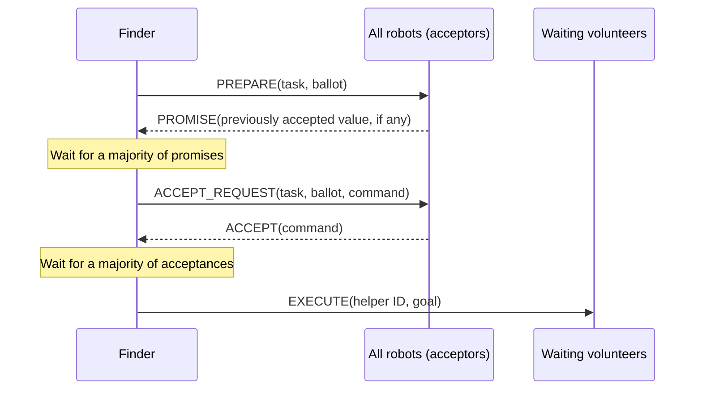

# CPR: Cooperative Robot Simulation

CPR is a Python simulation of robots working together to collect targets on a 2D grid. Robots explore the map, request help when they find a target, and use a Paxos-style consensus protocol to agree on a helper assignment. Collecting a target requires two robots to attempt the pickup together.

Matplotlib displays the simulation, while per-robot logs record movement, communication, and state changes. The robots and their messages are simulated in memory within one Python process.

## Getting started

Run these commands from the project directory in a Python 3 environment:

```sh
python -m pip install -r requirements.txt
python main.py
```

The dependencies are `matplotlib>=3.8` and `numpy>=1.26`. The animated view needs a graphical environment and an interactive Matplotlib backend.

For a shorter run with repeatable random choices:

```sh
python main.py --iterations 1000 --seed 42
```

On Windows, open live log viewers alongside the simulation:

```sh
python main.py --iterations 1000 --seed 42 --debug-panes
```

| Option | Behavior |
| --- | --- |
| `--iterations N` | Run for at most `N` iterations; must be positive. Default: `20000`. |
| `--seed N` | Seed NumPy's random generator for repeatable placement, exploration, and message delays. |
| `--debug-panes` | Open a live log viewer for each robot using Windows PowerShell. Windows Terminal is used when available. |
| `--help` | Display command-line usage. |

Close the map window or press `Ctrl+C` in the terminal to stop early. The terminal reports the iteration count, accumulated score, and final score.

## The world

The default settings are constants near the top of `main.py`:

| Setting | Default | Meaning |
| --- | --- | --- |
| `MAP_WIDTH`, `MAP_HEIGHT` | `10`, `10` | Grid dimensions. |
| `RANDOM_ROBOTS` | `4` | Number of robots created at startup. |
| `RANDOM_TARGETS` | `40` | Number of targets added whenever the map has none left. |
| `ITERATIONS` | `20000` | Default iteration limit. |
| `FRAME_DELAY_SECONDS` | `0.01` | GUI event-loop delay per frame; total iteration time also includes processing and drawing. |

Robots start at random positions and orientations. Targets are placed randomly when the simulation loop first runs, and a new batch appears after all existing targets have been collected. Positions are sampled independently, so robots and targets can overlap. The score continues accumulating across batches.

In the view:

- Red triangles represent robots; each triangle points in its facing direction.
- Labels such as `R0` identify robots.
- Green squares represent targets and are drawn beneath robots.
- Coordinates increase eastward along the x-axis and northward along the y-axis.

Overlapping targets share the same visual position, so fewer than 40 distinct green squares may appear in a batch.

## How the robots behave

### 1. Explore and discover a target

Every robot begins in `searching`. It senses the cell directly ahead and the robots sharing its current cell.

- If a target is directly ahead and that cell contains no robot, it moves onto the target and enters `found_target`.
- If both a target and a robot are ahead, it turns left or right with equal probability.
- Otherwise, it randomly moves forward with probability 60%, turns left with probability 20%, or turns right with probability 20%.

A forward action moves one cell. Each turn rotates the robot by 90 degrees. A move outside the map is rejected, leaving the robot in place for that iteration. Other robots do not physically block movement.

### 2. Recruit a helper

On its next decision in `found_target`, a robot alone on the target sets that cell as its goal, creates a task ID `(robot_id, task_counter)`, and enters `needs_help`.

The finder stays in place and broadcasts `Need_help` each iteration. A searching robot that receives the request becomes a `volunteer`, sends a `Help_offer`, and enters `wait_for_assignment`. Its offer includes its Manhattan distance to the goal:

```text
distance = abs(robot_x - goal_x) + abs(robot_y - goal_y)
```

The finder keeps the closest offer received during recruitment; equal-distance offers keep the first received candidate. It checks for a helper at the end of each 10-iteration waiting window. If nobody has offered, it continues requesting help.

To help when several robots are all requesting assistance, a finder with no helper selected can yield to a lower-ID requester. It broadcasts `CANCEL_TASK` for its own task and volunteers for the other one. Waiting volunteers for the canceled task are released, and delayed requests for that canceled task are ignored.

If a robot in `found_target` already shares its cell with exactly one other robot, it attempts a pickup directly. This still requires the other robot to choose pickup in the same iteration.

### 3. Agree on the assignment

The finder acts as the proposer in a Paxos-style exchange. Every robot, including the finder, acts as an acceptor. The command being agreed upon is `(helper_robot_id, goal_x, goal_y)`.



A majority is calculated as `number_of_robots // 2 + 1`, so the default four robots require three votes. Votes are counted once per robot and checked against the current task and ballot. Ballots use `(counter, proposer_id)`, and each acceptor keeps separate promise and acceptance records for each task. If promises report an already accepted command, the finder preserves the value associated with the highest accepted ballot.

If either voting phase times out after its 10-iteration waiting period, the finder starts another prepare round with a higher ballot. The `PROMISE_THRESHOLD` constant currently present in `main.py` is unused; the calculated majority controls agreement.

After agreement, the finder broadcasts `EXECUTE` and enters `wait_for_pickup`. The selected volunteer enters `move_to_goal`; the other volunteers for that task return to searching.

### 4. Travel and collect together

The selected helper follows a simple route: finish the horizontal distance first, then the vertical distance. It turns toward the required direction using the shorter turn direction, choosing left when both directions take the same number of turns. Turning and moving are separate actions.

When the helper is already at the goal at the start of its decision, it attempts a pickup. The finder attempts a pickup when it senses the selected helper in its cell.

A pickup succeeds only when:

1. The cell contains a target.
2. Exactly two robots in that cell plan `pick_up` during the same iteration.

Two robots merely standing together are not sufficient. More than two simultaneous pickup attempts are rejected. Extra robots standing in the cell do not invalidate a pickup unless they also attempt it.

A successful pair removes one target and adds one point to the world score. Even if several targets share the cell, only one is removed by that pickup. The finder and helper return to searching after planning their pickup attempt.

## Simulation timing and messages

Each iteration follows this order:

1. **Receive:** process messages whose delay counters have expired.
2. **Sense and decide:** each robot reads the world and plans at most one physical action.
3. **Validate:** check all planned actions against the rules using positions before any action executes.
4. **Act:** perform approved movement, turns, and pickups; rejected actions become idle.
5. **Send:** broadcast requests, consensus messages, and queued replies.

Messages are broadcast to every robot, including the sender. Other recipients receive independently randomized delay counters from 0 through 4; self-delivery uses a counter of 0. Messages sent at the end of an iteration can first be received in a later iteration. The simulation models delayed delivery but does not model message loss.

The following states appear in the logs:

| State | What the robot is doing |
| --- | --- |
| `searching` | Exploring or available to volunteer. |
| `found_target` | Has moved onto a target and is deciding whether to recruit or attempt pickup. |
| `needs_help` | Broadcasting requests and collecting helper offers. |
| `volunteer` | Sending an offer to help. |
| `wait_for_assignment` | Waiting for execution or cancellation of its recruitment task. |
| `wait_for_helper` | Starting or retrying a consensus proposal for a helper assignment. |
| `PREPARED` | Waiting for a majority of promises. |
| `ACCEPT_REQUEST` | Sending the proposed assignment for acceptance. |
| `ACCEPT_REQUESTED` | Waiting for a majority of acceptances. |
| `COMMANDER` | Broadcasting the agreed assignment. |
| `move_to_goal` | Traveling to the requested target. |
| `wait_for_pickup` | Staying at the target until the selected helper arrives. |

## Logs

Each run creates a timestamped directory beside the source files:

```text
logs/
  YYYYMMDD_HHMMSS_microseconds/
    robot_0.log
    robot_1.log
    ...
```

Log entries include the iteration number and robot ID. They record startup and shutdown, sent and received messages, pickup checks, and changes to state, position, orientation, goal, sensing results, and waiting counters. Orientations in the logs use indices: `0` = east, `1` = north, `2` = west, `3` = south.

Logs are saved whether or not `--debug-panes` is enabled. Live viewers require Windows PowerShell; with Windows Terminal they open as panes, otherwise as separate PowerShell windows. If viewers cannot open, the log files are still saved. Generated logs are excluded from Git.

## Project files

| File | Responsibility |
| --- | --- |
| `main.py` | Configuration, command-line entry point, animation, robot state machine, consensus handling, and iteration loop. |
| `robot.py` | Robot state, movement, sensing, distance calculation, message delivery, and per-task consensus records. |
| `map.py` | Grid cells, robot IDs and positions, target storage, and score. |
| `target.py` | Target coordinates and re-export of the pickup rule. |
| `rules.py` | Movement bounds, coordinated pickup rules, and validation of action plans. |
| `robot_logging.py` | Per-run log files, state-change logging, and optional live viewers. |
| `requirements.txt` | Python dependencies. |

## Current limitations

- Exploration is random and sensing is local. A searching robot does not automatically discover a target already underneath it.
- There are no internal obstacles, collision avoidance, or general pathfinding. Robots can share cells and move through one another.
- Random placement can create crowded target cells. The current `found_target` branch for more than two occupants resumes exploration instead of reliably choosing a pickup pair.
- State changes happen while planning actions. A rejected pickup does not undo a robot's transition back to searching, so a failed attempt can leave the target behind.
- Waiting volunteers and finders waiting for an assigned helper have no timeout for those states. The lower-ID yielding rule helps resolve competing requests, but collection of every target is not guaranteed.
- Finishing a target batch starts another batch; it does not end the run. The iteration limit, window closure, or interruption ends the simulation.
